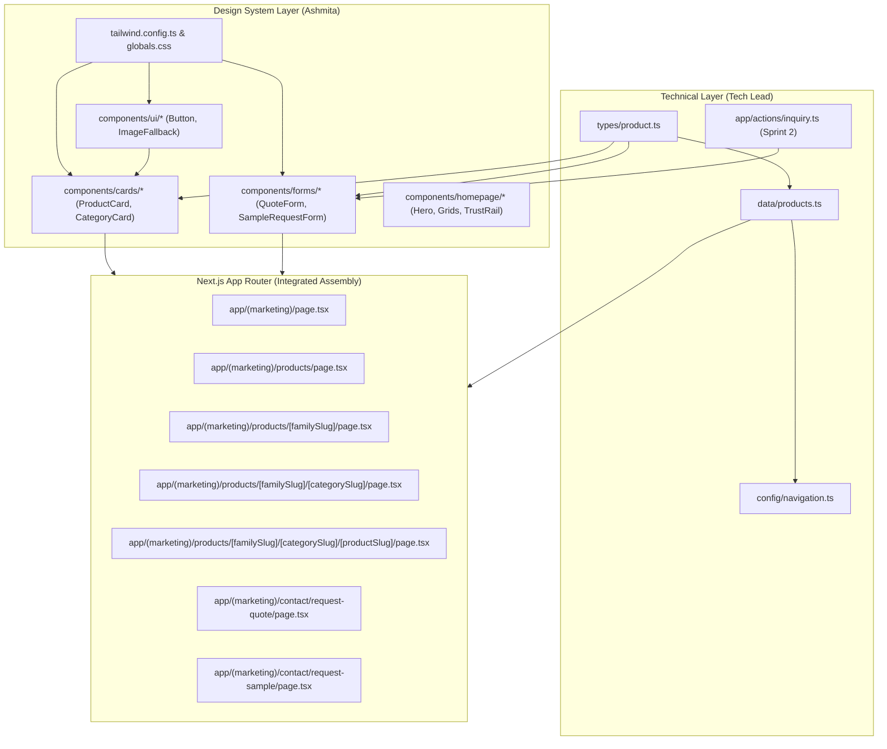

# Goyal Trading Company — Technical Dependency Map & Sprint 2 Roadmap
- **Author:** Technical Lead
- **Document:** Cross-Functional Architecture & Parallel Sprint Roadmap
- **Branches:** `feature/catalogue-functionality` (Tech Lead) & `feature/design-system-ui` (Ashmita)
- **Baseline Commit:** `ca1fedc`

---

## 1. System Dependency Architecture

The website is structured into three cleanly decoupled layers:
1. **Core Data & Typing Layer (Owned by Technical Lead)**: Single source of truth for product taxonomy, business discovery data, and navigation.
2. **Design Tokens & Component Layer (Owned by Ashmita)**: Tailwind CSS theme tokens, UI atoms, animations, and visual presentation cards.
3. **Route Integration & Page Assembly Layer (Shared / Coordinated)**: Next.js App Router RSC pages consuming typed data and rendering UI components.



---

## 2. File Ownership & Boundary Matrix

To prevent git conflicts during parallel worktree execution, file ownership is strictly partitioned:

| Path / Pattern | Primary Owner | Secondary Reviewer | Rules & Boundaries |
|---|:---:|:---:|---|
| `types/**/*.ts` | **Tech Lead** | Ashmita | All type contracts, interfaces, and enums defined here. UI imports types; does not redefine them. |
| `data/**/*.ts` | **Tech Lead** | Ashmita | Product inventory, business details, factory facts. UI consumes read-only data. |
| `config/**/*.ts` | **Tech Lead** | Ashmita | Navigation arrays, site configurations, SEO metadata defaults. |
| `app/actions/**/*.ts` | **Tech Lead** | - | Server actions, form submission handlers, email/notification dispatch. |
| `components/ui/**/*.tsx` | **Ashmita** | Tech Lead | Base atomic design components (`Button`, `ProductImageFallback`, inputs, badges). |
| `components/forms/**/*.tsx` | **Joint** | Joint | Ashmita owns markup/styling; Tech Lead owns form validation and action integration. |
| `components/cards/**/*.tsx` | **Ashmita** | Tech Lead | Visual presentation of `ProductCard`, `CategoryCard`. Must adhere to component contracts. |
| `components/homepage/**/*.tsx` | **Ashmita** | Tech Lead | Homepage visual redesign (Hero, TrustRail, ProductCategories, etc.). |
| `app/globals.css` | **Ashmita** | Tech Lead | CSS custom properties, utility layer, typography definitions. |
| `tailwind.config.ts` | **Ashmita** | Tech Lead | Color palettes, typography scales, spacing tokens, animations. |
| `app/(marketing)/products/**/page.tsx` | **Tech Lead** | Ashmita | Data querying, dynamic params generation (`generateStaticParams`), metadata. |
| `app/layout.tsx` | **Shared** | **Shared** | Root font loading and global meta. Requires explicit pre-merge coordination. |

---

## 3. Worktree & Git Synchronization Protocol

```mermaid
gitGraph
    commit id: "ca1fedc (baseline)"
    branch feature/design-system-ui
    checkout feature/design-system-ui
    commit id: "ashmita-tokens"
    commit id: "ashmita-cards"
    checkout master
    branch feature/catalogue-functionality
    checkout feature/catalogue-functionality
    commit id: "tech-audit-contracts"
    commit id: "tech-server-actions"
    checkout master
```

### Synchronization Rules:
1. **Never commit directly to `master`.**
2. **No cross-branch file edits:**
   - Ashmita does not edit files in `data/`, `types/`, or page lookup logic.
   - Tech Lead does not edit files in `components/homepage/`, `components/ui/`, or `tailwind.config.ts`.
3. **Component Contracts as Bridge:** All components authored by Ashmita must implement the prop interfaces defined in `design/component-contracts.md`.
4. **Rebase Cadence:** When interface changes are pushed, branches rebase on `origin/master` or cherry-pick approved contract updates.

---

## 4. Technical Blockers & Critical Path Dependencies

```
[Font Asset Delivery]  ──►  [Commit .woff2 to public/fonts/]  ──►  [next/font/local Setup]
                                                                          │
[Component Contracts]  ──►  [Ashmita UI Implementation]      ──►  [RSC Page Integration]
                                                                          │
[Server Actions Spec]  ──►  [Zod Validation Schemas]         ──►  [Quote & Sample Forms]
```

### Dependency 1: Physical Font Files (.woff2)
- **Status:** Blocking typography modernization (`next/font/local`).
- **Owner:** UI/UX Lead.
- **Action:** Deliver physical `.woff2` files for Outfit and Plus Jakarta Sans to `public/fonts/`.
- **Mitigation:** Stable CSS system font fallback is currently active and passing 100% of builds.

### Dependency 2: Product Imagery Assets
- **Status:** 16 products and 35 categories have zero physical images.
- **Owner:** Business / UI Team.
- **Action:** Source or photograph industrial garment samples.
- **Mitigation:** `ProductImageFallback` implemented and verified across all product and category loops.

### Dependency 3: Owner Confirmation Register
- **Status:** Unverified claims quarantined (2 production units, Indore DID phone number, client logos).
- **Owner:** Technical Lead / Project Owner.
- **Action:** Maintain conservative display until business owner confirms in writing.

---

## 5. Recommended Sprint 2 Implementation Tasks

### Track A: Technical Lead (`feature/catalogue-functionality`)
1. **Modularize Product Routes:**
   - Extract inline product grid and cards from `app/(marketing)/products/**/page.tsx` to consume Ashmita's modular `ProductCard` and `CategoryCard`.
   - Update `products/page.tsx` to compute categories and product counts dynamically instead of hardcoded `"50+"` and `"500+"` badges.
2. **Server Actions & Form Handling:**
   - Create `app/actions/inquiry.ts` supporting type-safe server submissions for Quote and Sample requests.
   - Implement Zod schema validation for B2B procurement inquiries.
   - Add URL query param parsing on `/contact/request-quote` and `/contact/request-sample` so product and category context is automatically filled.
3. **Structured Data & SEO:**
   - Implement JSON-LD `Product` schema on all 16 dynamic product detail pages.
   - Implement JSON-LD `BreadcrumbList` schema across the 3-level catalog hierarchy.

### Track B: Ashmita (`feature/design-system-ui`)
1. **Component Library Implementation:**
   - Build `components/cards/ProductCard.tsx` adhering to `ProductCardProps`.
   - Build `components/cards/CategoryCard.tsx` adhering to `CategoryCardProps`.
   - Build `components/products/ProductGallery.tsx` adhering to `ProductGalleryProps`.
   - Build `components/shared/SectionHeading.tsx` adhering to `SectionHeadingProps`.
2. **Forms Presentation:**
   - Build styled `QuoteForm.tsx` and `SampleRequestForm.tsx` in `components/forms/`.
3. **Homepage V2 Execution:**
   - Implement approved Homepage V2 sections (Hero kinetic headline, Trust Statistics rail, Product Categories carousel) in `components/homepage/`.
